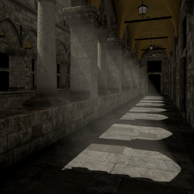

# Renderer

GPU-driven renderer (Vulkan 1.4).

I've learned a lot from [niagara](https://github.com/zeux/niagara) (Vulkan renderer by Arseny Kapoulkine) and recommend checking out his streams and blog posts, it's a gold mine of knowledge about graphics, Vulkan and optimizations.

## Preview



## Features

- RHI (Vulkan 1.4 backend)
- GPU-driven rendering (bindless textures, indirect drawing, GPU culling)
- visibility buffer -> "forward" rendering
- async compute
- GPU frustum culling
- GPU 2-pass Hi-Z occlusion culling
- PBR (metallic workflow, no IBL)
- normal mapping
- HDR (HDR -> SDR)
- TAA
- SSAO
- stable cascaded shadow maps (CSM) with soft shadows (PCF with adaptive sampling)
- fog (participating media)
- very simplified atmospheric scattering

## Frame overview (passes)

- (G) is graphics (vert/frag)
- (C) is compute (comp)
- branches represent async compute
- debug passes are not shown

```
cull_early (C)
  |
vis_buf_early (G)
  |
depth_reduce (C)
  |
cull_late (C)
  |
vis_buf_late (G)
  |
  +--------------------------+
  |                          |
csm_cull (C)               depth_view_quarter_res (C)
  |                          |
csm (G)                    ssao (C)
  |                          |
  +---------------------+  blur_x (C)
  |                     |    |
fog (C)                 |  blur_y (C)
  |                     |    |
blur_x (C)              |  upsample (C)
  |                     |    |
blur_y (C)              +----+
  |
render (C)
  |
taa_resolve (C)
  |
fullscreen (G)
```

## Build and run

Dependencies (included as git submodules):

- EASTL
- SDL
- volk
- VulkanMemoryAllocator
- SPIRV-Reflect
- imgui
- cgltf
- KTX-Software
- meshoptimizer

You also need [Vulkan SDK](https://vulkan.lunarg.com/sdk/home) (not bundled).

Building SDL may require [additional dependencies](https://github.com/libsdl-org/SDL/blob/main/docs/README-linux.md#build-dependencies) depending on your OS.

```
git submodule init
git submodule update
cmake -B Build -DCMAKE_BUILD_TYPE=Release -G Ninja
cmake --build Build
```

To run, you need the [Intel Sponza](https://www.intel.com/content/www/us/en/developer/topic-technology/graphics-research/samples.html) asset, download it and put it in the `Assets` directory.

You also need to convert png textures to ktx2, using `ktx` utility from [KTX-Software](https://github.com/KhronosGroup/KTX-Software):

```
git clone https://github.com/KhronosGroup/KTX-Software.git
cd KTX-Software
cmake . -G Ninja -B build -DCMAKE_BUILD_TYPE=Release -DKTX_FEATURE_TOOLS=ON
cmake --build build
```

After building and installing (install somewhere in the `PATH`, put `libktx.so` there too):

```
cd Assets
./toktx_intel_sponza.sh
```

This will take a while.

## Controls

- WASD/ZX -- position control, Z/X are down/up
- Escape -- close
- r -- reload shaders (after recompiling with CMake)
- . -- toggle fullscreen
- u -- toggle UI
- m -- toggle mouse
- c -- freeze camera to visualize culling
- 1, 2, ... -- switch between render modes
